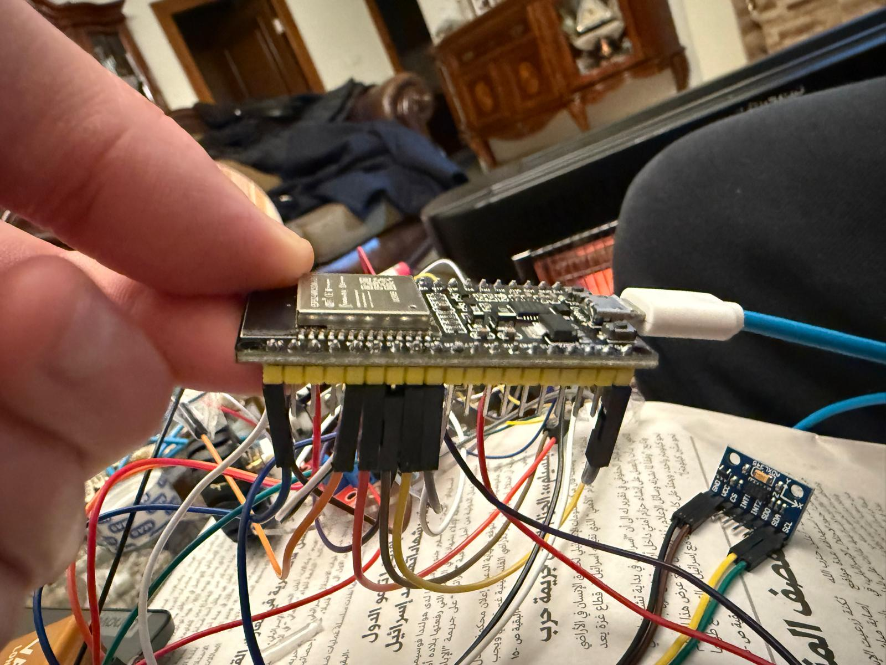

# ESP32 Maze-Navigation Robot

A physical robot prototype built and programmed by **Johny Bajjali** at **Birzeit University** as part of the **Interfacing Techniques** course and Micromouse maze-navigation project.

The project combines motor control, wheel-encoder feedback, an MPU6050 IMU, and three distance sensors. Development was documented on the course Trello board through incremental code, result images, and video attachments.

## Project Objective

The Micromouse assignment requires an autonomous, self-contained robot to navigate an initially unknown maze from a corner starting cell to the four-cell central goal in the shortest possible time.

## Hardware Used

| Component | Quantity / arrangement | Purpose |
|---|---|---|
| ESP32 development board | One | Main controller |
| VL53L0X distance sensors | Three: left, front, right | Wall and obstacle distance measurements |
| MPU6050 IMU | One | Angular-rate feedback used to estimate yaw |
| L298N motor driver | One | Left/right motor direction and speed control |
| Geared DC motors and wheel encoders | Left and right channels | Motion and encoder-pulse feedback |
| Wheels and chassis | Mobile robot assembly | Mechanical movement and support |
| Batteries, wiring, and connectors | Onboard power and connections | Power distribution and component integration |

## My Work

- Assembled the robot and wired its electronics.
- Programmed the ESP32 using C/C++ in the Arduino IDE.
- Integrated motor control, wheel encoders, the MPU6050, and the distance sensors.
- Developed movement and turning routines and carried out hardware tests.
- Worked on PID-based direction control and sensor-based obstacle decisions.
- Documented successive development stages using code, images, and videos on Trello.

## Development Stages Documented on Trello

| Stage | Work recorded |
|---|---|
| Motor and encoder control | Motor-direction pins, PWM speed control, encoder interrupts, and pulse counting |
| Adding MPU6050 | Reading angular rate, estimating yaw, and applying PID-based motor-speed correction |
| MPU with rotation | State-based forward movement and target-angle turning routines |
| Distance-sensor detection | Initialising three VL53L0X sensors and printing left/front/right measurements |
| Combined robot code | Combining motor control, encoders, IMU/PID, and distance-based navigation decisions |

These stages describe the code recorded on the board. They do not establish that every routine worked correctly together in a completed maze run.

## Control and Navigation

The combined sketch recorded in the board's **full code** card includes:

- Left/right motor PWM and direction outputs.
- Encoder interrupt handlers that count wheel pulses.
- MPU6050 gyroscope readings, with yaw estimated by integrating the Z-axis angular rate.
- A PID controller intended to adjust motor speeds for heading correction.
- A periodic control callback configured for **50 ms**.
- Left, front, and right distance measurements with an obstacle threshold of **150 mm**.
- States named `FORWARD`, `TURN_LEFT`, `TURN_RIGHT`, and `TURN_180`.
- Right-hand-rule-style decisions based on nearby obstacles and open directions.

Encoder counters are present in the combined sketch, but they are not used there to implement a closed-loop wheel-speed or travelled-distance controller.

### Maze Algorithms and Simulation Coursework

The Trello board also documents **left-hand rule**, **right-hand rule**, and **flood-fill** simulation coursework, with links to shared simulation code and videos. Those shared GitHub implementations are not presented here as Johny's individually authored code.

The physical combined sketch uses sensor-based turning decisions; it does not contain a flood-fill maze map or shortest-path planner. Simulation coursework and physical robot integration are separate parts of the course project.

## Pin Assignments in the Recorded Combined Sketch

| Connection | ESP32 GPIO |
|---|---|
| Right motor direction: AIN1 / AIN2 | 18 / 19 |
| Left motor direction: BIN1 / BIN2 | 23 / 25 |
| Right motor PWM: PWMA | 5 |
| Left motor PWM: PWMB | 4 |
| Left encoder A / B | 34 / 35 |
| Right encoder A / B | 32 / 26 |
| Left sensor control | 17 |
| Front sensor control | 16 |
| Right sensor control | 13 |

The sensor test sketch explicitly uses the three sensor-control pins as XSHUT lines and assigns separate I2C addresses. Its initialisation differs from the combined sketch, so the table records assignments rather than guaranteeing interchangeable working configurations.

## Software and Libraries

The recovered physical-robot sketches reference:

- Arduino IDE and the Arduino framework for ESP32.
- `Arduino.h` and `Wire.h`.
- Adafruit MPU6050 and Adafruit Unified Sensor.
- Adafruit VL53L0X.
- `PID_v1`.
- ESP32 timer and interrupt facilities.

Different development sketches use different PWM APIs. Their original ESP32 core/library versions and hardware behavior have not been revalidated for this showcase.

## Prototype Photo

## Demonstration Videos

- [Robot movement test 1](robot_2.mp4)
- [Robot movement test 2](robot_3.mp4)

These recordings show movement tests on an open floor. The robot was built and tested, but complete maze solving was not achieved.

## Micromouse Assignment Requirements

The following specifications come from the supplied five-page **Micromouse Competition** handout. They are assignment requirements, not measured results for the prototype.

| Requirement | Specification |
|---|---|
| Maze grid | 16 × 16 cells |
| Cell dimensions | 18.2 × 18.2 cm, excluding wall thickness |
| Approximate clear cell interior | 16.8 × 16.8 cm |
| Wall height | 5 cm |
| Wall thickness | 1.2 cm |
| Start | One corner cell |
| Goal | Four central cells with one entrance to the goal region |
| Robot size | Each dimension below 20 cm |
| Maximum component cost | US$200 |
| Total maze-access time | 12 minutes, including adjustments between runs |
| Touching during a run | Run aborted; 20-second penalty on the next run |
| Design presentation | Up to 8 minutes, followed by 3 minutes of questions |

The robot must operate without outside control signals, must not damage or cross over maze walls, and must not receive maze information after the maze is revealed. Multiple routes may exist. The handout explicitly states that wall hugging alone cannot reach the goal in the specified maze.

The handout also refers to an **mms** simulator, a VirtualBox virtual machine, and three sample mazes. The design presentation covers component costs, navigation approach, mechanical/electrical/software choices, performance, and possible improvements.

## Author

**Johny Bajjali**  
Computer Engineering — Birzeit University  
[GitHub](https://github.com/JohnyBajjali)
